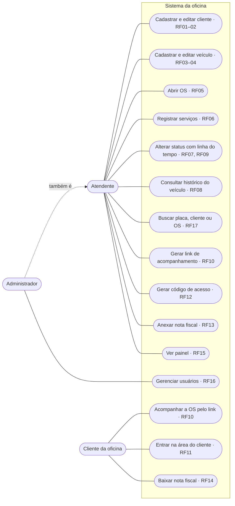
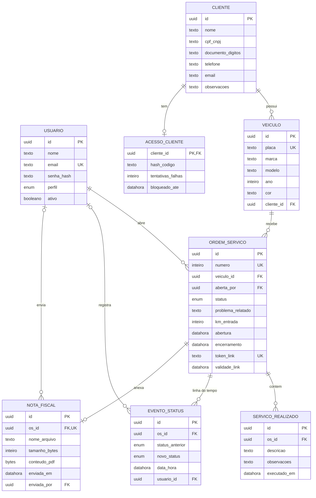
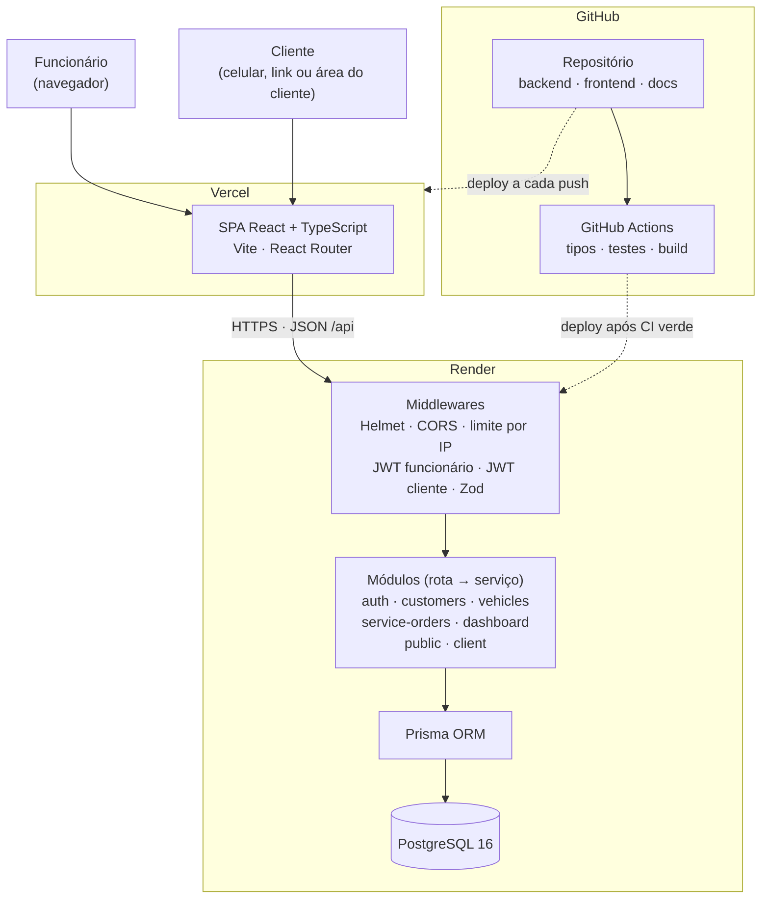

# Diagramas

Fonte dos diagramas usados no artigo (o GitHub desenha os blocos `mermaid`).

## Casos de uso

## Modelo de dados

Nomes conceituais; no código: `User`, `Customer`, `Vehicle`, `ServiceOrder`, `ServiceItem`, `StatusEvent`,
`CustomerAccess` e `OrderInvoice` (`backend/prisma/schema.prisma`).

## Arquitetura

